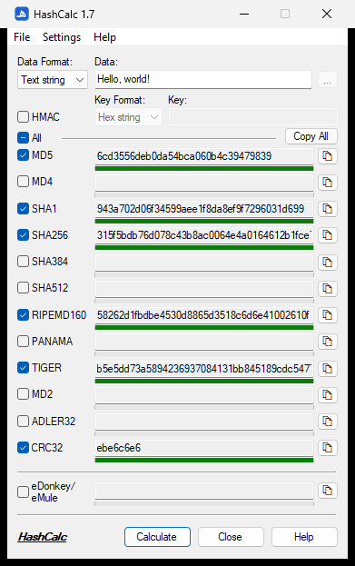
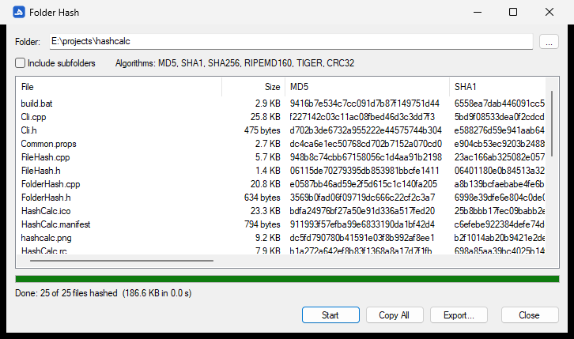

# HashCalc

A small, fast hash calculator for Windows. It works as a normal window **and** as a command line tool, in one portable `.exe` file. There is nothing to install.

<br clear="left">

<p align="center">
  
</p>

## What it can do

- **13 hash types:** MD5, MD4, MD2, SHA1, SHA256, SHA384, SHA512, RIPEMD160, PANAMA, TIGER, ADLER32, CRC32 and eDonkey/eMule.
- **HMAC** with a text or hex key.
- **Files, text or hex** as input. You can also drag and drop a file onto the window.
- **Fast:** each hash runs on its own thread. A small bar and a percentage show the progress.
- **Copy** one result with the copy button, or everything with **Copy All**.
- **Hash a whole folder**, then export the results as CSV or as a checksum file.
- **Right-click menu in Explorer** (optional): "Calculate hash with HashCalc".
- **Command line** for scripts, including checking files against a checksum list.
- **Always on top** (Settings menu or Ctrl+T), so the window stays visible.
- **Single Instance** (Settings menu, off by default): opening HashCalc again, or right-clicking a file in Explorer, uses the window that is already open. Files sent while it is busy are hashed one after another.
- **Cancel** a running calculation, and **Reset** (Ctrl+R) everything back to the defaults.
- **Add to PATH** (optional), so you can type `hashcalc` in any console window.

## How to use

1. Run `HashCalc.exe` (from `dist\x64`, or `dist\x86` on 32-bit Windows).
2. Choose a file, or just type or paste text. **Data Format** changes by itself: a path selects *File*, other text selects *Text string*. For hex input, choose *Hex string* yourself.
3. Tick the hash types you want. **All** ticks or clears every box.
4. Click **Calculate**. While it works, the same button says **Cancel**, so you can stop it.

HashCalc remembers the hash types you ticked for next time. **File > Reset** (Ctrl+R) clears everything and goes back to the default settings.

## Hash a folder

Use **File > Hash Folder** or drop a folder onto the window. Tick **Include subfolders** if you need them, then click **Start**. It uses the hash types ticked in the main window.

<p align="center">
  
</p>

**Export...** saves the results as a CSV file (for Excel) or as a checksum file such as `.sha256`.

## Explorer right-click menu

Turn on **Settings > Add to Explorer Context Menu**. Then you can right-click any file or folder and choose *Calculate hash with HashCalc* or *Hash folder with HashCalc*. Click the menu item again to remove it.

- On Windows 11 you find it under **Show more options**.
- No admin rights are needed. It only changes your own user settings.
- If you move `HashCalc.exe`, turn the option on again.

## Command line

Open Command Prompt, PowerShell or Terminal and run HashCalc with options.

To type just `hashcalc` from any folder, use **Settings > Add to PATH (Command Line)...** once:

1. Choose a folder for HashCalc. The default is `%LOCALAPPDATA%\Programs\HashCalc`, which only you can change. If you choose a folder that other users can write to (like `C:\tools` on many PCs), HashCalc warns you first.
2. Click **Add to PATH**. HashCalc copies `HashCalc.exe` to that folder and adds the folder to your user PATH, so no admin rights are needed.
3. Open a **new** Command Prompt or PowerShell window and type `hashcalc -h`.

Click the menu item again to remove the folder from your PATH. HashCalc then asks if it should also delete the copy. After you download a new version, remove and add it again to update the copy.

```
HashCalc setup.exe                          SHA256 of one file
HashCalc -md5 -sha1 *.iso                   several hash types, wildcards
HashCalc -sha256 -r D:\Photos               all files in a folder and its subfolders
HashCalc -all -s "hello"                    hash a text string
HashCalc -sha256 -sum -r D:\Release > release.sha256    make a checksum file
HashCalc -c release.sha256                  check the files later
HashCalc -gui                               open the window
HashCalc -h                                 show all options
```

Example output:

```
> HashCalc -md5 -sha256 abc.txt
HashCalc 1.7 - file and text hash calculator

abc.txt
  MD5     900150983cd24fb0d6963f7d28e17f72
  SHA256  ba7816bf8f01cfea414140de5dae2223b00361a396177a9cb410ff61f20015ad

> HashCalc -nologo -c files.sha256
sub\deeper\x1000.bin: OK
sub\hello world.txt: OK

2 OK, 0 FAILED, 0 unreadable
```

Useful options:

| Option | Meaning |
|---|---|
| `-md5`, `-sha256`, ... | choose hash types (default: SHA256) |
| `-a md5,sha1` / `-all` | a list of hash types / all of them |
| `-r` | include subfolders |
| `-s "text"` / `-x 616263` | hash a text / hex string |
| `-hmac key` / `-hmachex key` | use HMAC |
| `-sum` / `-csv` / `-bare` | checksum file / CSV / only the hashes |
| `-upper` | uppercase letters |
| `-o file` | save the output to a file |
| `-nologo` | do not show the banner line |
| `-c file` | check files against a checksum file |
| `-allow-unc` | with `-c`: also check network paths (`\\server\...`) in the checksum file |
| `--` | end of options: everything after it is a file name |

Checksum files work with `sha256sum` / `md5sum`. Exit code: `0` = OK, `1` = a file failed or did not match, `2` = wrong options.

## Requirements

- Windows 10 or 11 (64-bit or 32-bit).
- No runtime or installer needed.
- On Windows 10 and Windows 11 before version 24H2, a black console window may flash for a moment when you open HashCalc from Explorer.

## Security

- HashCalc loads Windows DLLs only from `System32`, so a harmful DLL next to `HashCalc.exe` (for example in your Downloads folder) is not loaded.
- `-c` skips network paths (`\\server\...`) in checksum files, because opening them sends your Windows login to that server. Use `-allow-unc` if you trust the file.
- CSV export and **Copy All** add a `'` in front of cells that start with `=`, `+`, `-` or `@`, so Excel shows them as text, not formulas.
- Use **SHA256** or **SHA512** to check that a file was not changed on purpose. MD5, SHA1, MD2 and MD4 are fine for spotting broken downloads, but they are not safe against attackers.

## Build from source

You need **Visual Studio 2022** with the *Desktop development with C++* workload.

- Open `HashCalc.sln` and press **F5**, or
- run `build.bat` (x64), `build.bat x86` or `build.bat all`.

`build.bat` adds 1 to the minor version each time it runs. It puts the finished files in the `dist` folder.

To make the icon again: `python tools/make_icon.py res/HashCalc.ico` (needs Pillow).

## Project layout

```
hashcalc/
├─ HashCalc.sln           Visual Studio solution (open this)
├─ HashCalc.vcxproj       project file
├─ Common.props           shared build settings (small, portable Release build)
├─ build.bat              release build, writes dist\<arch>\HashCalc.exe
├─ src/
│  ├─ core/               hash algorithms (Hashes) and file/folder hashing (FileHash)
│  ├─ gui/                main window, Folder Hash window, settings and Explorer menu
│  ├─ cli/                command line mode
│  ├─ common/             small helpers (paths, clipboard, window layout)
│  └─ version.h           version number, updated by build.bat
├─ res/                   dialogs, menus, icon, manifest and version info
├─ docs/                  images (see below)
└─ tools/
   └─ make_icon.py        makes res/HashCalc.ico
```

`build/` and `dist/` are created when you build. Git ignores them.

### docs folder

| File | What it is |
|---|---|
| `main-window.png` | screenshot of the main window (used above) |
| `folder-hash.png` | screenshot of the Folder Hash window (used above) |
| `icon.png` | the app icon, the Arabic letter H (هـ) |
| `hashcalc.png` | the original HashCalc window this project's design is based on |
